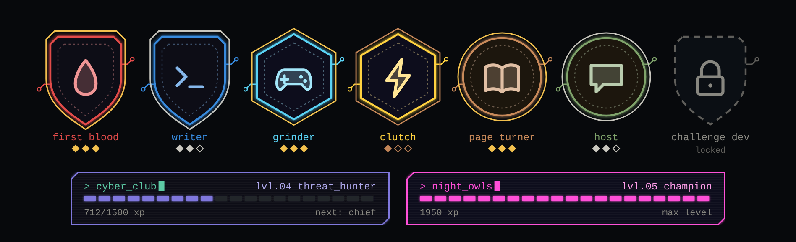

# xp-kit

**Levels, badges and a leaderboard for any club, team or community. Free, open source, and run entirely on GitHub.**

Members earn XP for showing up and contributing, level up, unlock badges, and show them off on their
GitHub profiles. You design the whole thing (the levels, the badges, the look) in one config file, or let
any LLM design it for you.



- **No servers, no cost.** GitHub Actions does the work, GitHub Pages hosts the leaderboard.
- **Your design.** Shield, hex or coin badges; any colors; 16 built-in icons plus your own.
- **Make badges with any LLM.** Copy-paste prompts in [PROMPTS.md](PROMPTS.md) for ChatGPT, Claude, Gemini or
  anything else. Every generated icon is checked and rebuilt from an allowlist, so a bad SVG can't break or
  attack your site.
- **Live profile badges.** Members paste one snippet into their GitHub README, and their level and badges stay up to date.
- **Runs itself.** Members join with an issue form; organizers award XP with a `/award` comment; level-ups post
  to Discord.
- **Fair by design.** Officer-only awards, no double counting, award caps, and an append-only ledger you can audit.

## Quick start

1. Click **Use this template → Create a new repository** (public, ideally under your group's org).
2. Clone it and run `./setup.sh` (needs the [GitHub CLI](https://cli.github.com)).
3. Make it yours: edit `xp-config.yml`, or paste [PROMPTS.md #1](PROMPTS.md#1-design-your-whole-xp-system) into any LLM.

Your board goes live at `https://<owner>.github.io/<repo>`. The **[playbook](PLAYBOOK.md)** covers designing an XP
system people care about, launching it, running it weekly, and handing it off.

## Preview your badges locally

```bash
pip install pyyaml
python scripts/xp.py preview          # open _preview/index.html
python scripts/xp.py validate         # check config, icons and data
```

Try the examples: `python scripts/xp.py --config examples/configs/esports.yml preview`

| Example | Look |
|---|---|
| [`cyber-club.yml`](examples/configs/cyber-club.yml) | shields, terminal green, CTF-themed badges |
| [`esports.yml`](examples/configs/esports.yml) | neon hex badges, custom controller icon, rank-style levels |
| [`book-club.yml`](examples/configs/book-club.yml) | warm coin badges, no seasons |

## How it works

```
Join XP issue form ──► join workflow ──► data/members.json ─┐
/award comment ──────► award workflow ─► data/ledger.jsonl ─┼─► build workflow ─► GitHub Pages
other repos ─────────► dispatch ───────► data/ledger.jsonl ─┘        │              leaderboard + badge SVGs
                                                                      └─► Discord: level-ups and new badges
```

- `data/ledger.jsonl` is the source of truth: one line per XP event. Totals, levels and badges are always
  recomputed from it, so changing point values or badge rules in the config re-scores everyone instantly.
- Badge URLs are stable (`/badges/<user>/<badge>.svg`) and show a locked state until earned, so embeds never break.

## Commands

| Command | What it does |
|---|---|
| `python scripts/xp.py preview` | Gallery of every badge in every tier, plus level cards and built-in icons |
| `python scripts/xp.py validate` | Checks config, custom icons and data, with plain-English errors |
| `python scripts/xp.py check-icon [files]` | Checks custom icon SVGs (all of `icons/` by default) |
| `python scripts/xp.py build` | Builds the full site into `_site/` |
| `python scripts/xp.py add --user alex --source attendance --ref 2027-01-20` | Records XP from the command line |

Add `--config path.yml` or `--data-dir path/` to any command to point at other files.

## Docs

- [PLAYBOOK.md](PLAYBOOK.md): setup, design, launch, running it, fairness, handoff, troubleshooting
- [PROMPTS.md](PROMPTS.md): LLM prompts for configs, icons, themes and announcements
- [icons/README.md](icons/README.md): custom icon rules

## Credits

Built by [Kevin Watson](https://github.com/cyber-tech-kev). It started as the XP system for my college's
cybersecurity club and was generalized so any group can use it. Issues and pull requests are welcome.

## License

[MIT](LICENSE)
